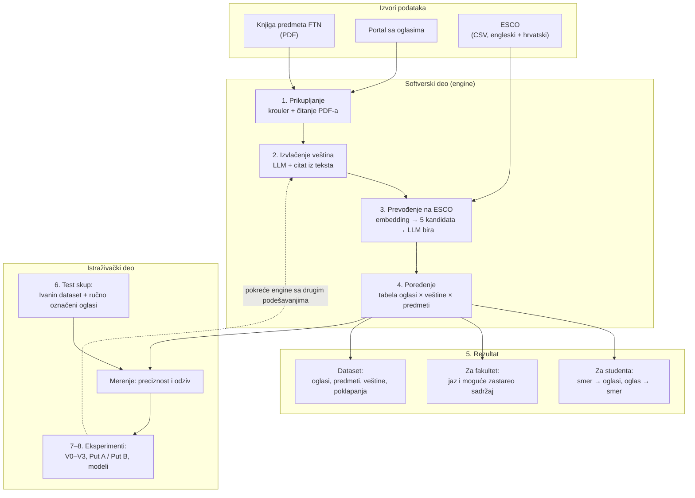

# Istraživački dnevnik

**Projekat 11 — Procena relevantnosti kurikuluma analizom oglasa za posao**
(*Curriculum Relevance Assessment by Analyzing Job Ads*)

Autor: Goran Malešev (E2 162) · Mentor: Goran Savić

---

## 0. Projekat ukratko

1. Iz 2–3 predmeta smera Računarstvo i automatika na FTN-u (uz nastavne materijale) i iz oglasa za posao izvlačim **listu veština**.
2. Obe liste prevodim na **iste standardne nazive** (ESCO), da bih mogao da ih uporedim.
3. Za svaki oglas računam **meru poklapanja u oba smera**: koliko traženih veština smer pokriva i koliko od onoga što smer uči oglas traži. Tako student dobija listu poslova koji odgovaraju njegovom smeru, a fakultet vidi šta mu nedostaje.
4. Sve što prikupim i izračunam čuvam kao **dataset** (celi oglasi, predmeti, veštine), koji je i sam jedan od rezultata.

**Šta je novo u odnosu na najbliži rad (Turaev i sar., 2026):** oni koriste samo ishode učenja i 30 oglasa. Ja proveravam da li uparivanje postaje tačnije kada predmetu dodam još izvora (ishode, sadržaj, materijale), i to merim na ručno proverenim primerima.

Kako su delovi sistema povezani: odeljak 3 (Arhitektura sistema).

---

## 0.1 Kako metodologija pokriva zadatak projekta

| Zahtev iz zadatka | Gde se rešava |
|---|---|
| Izdvojiti kompetencije iz kurikuluma i oglasa | Korak 2 |
| Uporediti ih | Koraci 3 i 4 |
| Pokazati šta kurikulum dobro pokriva | Korak 4 (pokrivenost oglasa) |
| Pokazati nedostatke | Korak 5 (jaz) |
| Pokazati zastarele sadržaje | Korak 5 (uči se, a ne traži se) |
| Obogatiti kratke tekstove dodatnim izvorima | Korak 7 (V0–V3, opis firme) |
| Istražiti koji izvori najviše doprinose | Korak 7 + ručna provera iz koraka 6 |
| Prototip za jedan domen | Korak 5 (aplikacija), domen: FTN, smer Računarstvo i automatika |
| Dataset kao rezultat (smernica profesora) | Korak 1 i modul `dataset` |

## 0.2 Šta preuzimam od Turaeva i sar. (2026), a šta radim drugačije

| | Turaev i sar. | Moj projekat |
|---|---|---|
| Program | Računarstvo, UAE University, 85 predmeta | FTN, Računarstvo i automatika |
| Šta čitaju iz predmeta | samo ishode učenja | opis, ishode, sadržaj, materijale (poredim šta pomaže) |
| Oglasi | 30, isečeni na rečenice-zahteve (483) | ~200, iz njih LLM izvlači veštine |
| Izvlačenje veština | dva LLM-a, neslaganja se rešavaju u dva koraka | jedan LLM (fiksiran model), uz citat iz teksta |
| Standardizacija | ESCO, SBERT, prag sličnosti 0,50 | ESCO preko višejezičkog embeddinga + LLM bira tačnu veštinu; poredim i put bez ESCO-a |
| Provera | uzorak od 50 zapisa, Cohenov κ = 0,79 za polje veštine | ručno označenih 50 oglasa, preciznost i odziv |
| Jezik | engleski | srpski + engleski |
| Rezultat | jaz po oblastima računarstva | jaz + lista poslova za studenta |

Pored Turaeva, koristim ideje iz još dva rada:
- **Andonovikj i Boškoski (2024)** uparuju tekst sa ESCO veštinama samo pomoću embeddinga i kosinusne sličnosti, bez dodatne provere. Tu ideju koristim u **Putu B** (korak 8), s tim što veštinu iz oglasa ne poredim sa ESCO-om, nego direktno sa veštinama iz predmeta.
- **Pelucchi i sar. (2026)** uparuju u dva koraka. Prvo embedding brzo pronađe nekoliko najsličnijih veština (kandidata). Među njima je obično i tačna, ali ima i pogrešnih. Zatim LLM pregleda kandidate i odluči koji je tačan. Isto radim u **koraku 3**: za veštinu „SQL upiti“ embedding vrati 5 kandidata (npr. SQL, PL/SQL, MySQL, NoSQL, upravljanje bazama podataka), a LLM izabere **SQL**. Sam embedding bi lako izabrao pogrešnu veštinu, npr. MySQL, jer je i ona značenjem blizu.

## 1. Osnovni pojmovi (onako kako ih ja koristim)

| Pojam | Šta znači u ovom projektu |
|---|---|
| **Kurikulum** | Spisak predmeta smera sa opisom, ciljem, ishodima i sadržajem svakog predmeta. |
| **Oglas** | Tekst oglasa za posao: šta se radi i šta se traži od kandidata. |
| **Veština** | Jedna konkretna stvar koju neko zna ili ume: „SQL“, „Java“, „rad u timu“. |
| **Ekstrakcija veština** | Iz teksta izvučem listu veština. Npr. iz „Iskustvo sa Javom i Spring Bootom“ dobijem `[Java, Spring Boot]`. |
| **ESCO** | Evropski spisak veština. Svaka veština ima jedan standardni naziv i ID. Koristim ga kao rečnik da „JS“, „JavaScript“ i „Javascript programiranje“ postanu ista stavka. |
| **Mapiranje na ESCO** | Za veštinu iz teksta nađem kojoj ESCO veštini odgovara. |
| **Embedding** | Tekst pretvoren u niz brojeva. Tekstovi sličnog značenja dobijaju slične nizove, pa mogu da merim koliko su dva teksta slična. |
| **Kosinusna sličnost** | Broj koji kaže koliko su dva embeddinga slična: blizu 1 znači „isto značenje“, blizu 0 znači „nema veze“. |
| **Višejezički model** | Embedding model koji „baze podataka“ i „databases“ smešta blizu, pa mogu da poredim srpski i engleski tekst. |
| **LLM** | Veliki jezički model (npr. GPT, Claude). Koristim ga za izvlačenje veština iz teksta i za proveru da li je neko uparivanje tačno. |
| **Pokrivenost oglasa** | Koliki deo veština iz oglasa smer pokriva. Oglas traži 8 veština, smer pokriva 4: pokrivenost je 4/8 = 50%. |
| **Jaz (skills gap)** | Veštine koje se često traže u oglasima, a nijedan predmet ih ne pokriva. |
| **Obogaćivanje** | Kratkom opisu predmeta dodam još teksta (ishode, sadržaj, materijale) da bi se lakše videlo šta se na predmetu uči. |
| **Referentni skup** | Mali skup primera koje sam **ručno** proverio. Služi da izmerim koliko sistem greši. |
| **Krouler** | Program koji automatski skida tekstove sa sajta (npr. oglase). |

---

## 2. Metodologija: šta konkretno radim

Postupak objašnjavam na jednom primeru. **Nazivi predmeta, tekst oglasa i brojevi u primeru su izmišljeni i služe samo za ilustraciju.** Prave vrednosti će biti u pilotu.

### Korak 1 — Prikupljam podatke

**Kurikulum.** Fokusiram se na **2–3 predmeta** smera *Računarstvo i automatika*. Za njih ne uzimam samo knjigu predmeta (naziv, cilj, ishodi, sadržaj, literatura), nego i **nastavne materijale** (slajdove, zadatke), jer oni najbolje pokazuju šta se na predmetu stvarno uči. Engine pravim generički, tako da se kasnije isti postupak pokrene za bilo koji predmet ili smer.

**Oglasi.** Sa portala (LinkedIn, Infostud, HelloWorld; konačan izbor zavisi od uslova korišćenja) prikupljam oglase za poslove koji odgovaraju smeru („Java developer“, „Software engineer“, „QA engineer“...). Za početak je dovoljno oko 200 oglasa. Pre prikupljanja proveravam uslove korišćenja sajta i `robots.txt`. Ne čuvam lične podatke, a sirove oglase ne stavljam u javni repozitorijum.

**Dataset kao rezultat.** Sve što prikupim i obradim čuvam kao skup podataka (dataset), koji je i sam jedan od rezultata projekta:

| Deo dataseta | Šta sadrži |
|---|---|
| `oglasi` | ceo tekst oglasa, naziv pozicije, firma, izvor, link, datum prikupljanja |
| `predmeti` | naziv, cilj, ishodi, sadržaj, nastavni materijali (tekst) |
| `vestine` | za svaki oglas i predmet: veština, citat iz teksta, ESCO naziv i ID |
| `poklapanja` | za svaki par oglas–smer: mera poklapanja u oba smera |

Za testiranje koristim i **Ivanin dataset**, koji mi je profesor odredio kao test skup (vidi korak 6).

*Primer:*
> **Predmet „Baze podataka“** — Ishodi: student ume da projektuje relacionu bazu i piše SQL upite. Sadržaj: ER model, normalizacija, SQL, transakcije, PostgreSQL.
>
> **Oglas „Junior Backend Developer“** — Tražimo: Java, Spring Boot, SQL (PostgreSQL), REST API, Git, Docker, dobra komunikacija.

### Korak 2 — Iz svakog teksta izvlačim listu veština

LLM-u dam tekst i tražim da vrati listu veština. Uz svaku veštinu mora da navede i deo teksta iz kog ju je izvukao, da bih mogao da proverim da nije izmislio.

**Napomena (profesor, 23.11.):** tehniku izvlačenja treba preispitati. Pored LLM-a razmatram i jednostavnije tehnike (npr. traženje ESCO naziva i sinonima direktno u tekstu) i modele specijalizovane za izvlačenje veština iz oglasa. Izbor donosim poređenjem na test skupu.

*Primer:*
- Predmet „Baze podataka“ → `[projektovanje relacionih baza, SQL, normalizacija, transakcije, PostgreSQL]`
- Oglas → `[Java, Spring Boot, SQL, PostgreSQL, REST API, Git, Docker, komunikacija]`

### Korak 3 — Prevodim veštine na ESCO nazive

Problem: ista veština se piše na različite načine („SQL upiti“, „SQL“, „rad sa bazama“). Zato svaku veštinu prevodim na ESCO naziv:

1. Svaku ESCO veštinu jednom pretvorim u embedding.
2. Veštinu iz teksta pretvorim u embedding i nađem 5 najsličnijih ESCO veština.
3. LLM bira koja od tih 5 je tačna, ili kaže „nijedna“.

*Primer:* „SQL upiti“ → kandidati iz ESCO-a → LLM bira **SQL**.

Posle ovog koraka i predmeti i oglasi su **liste ESCO veština**, pa ih mogu direktno porediti.

**Napomena o jeziku:** ESCO postoji na 28 jezika, ali **srpski nije među njima** (hrvatski jeste). Zato veštine sa srpskog ne tražim po nazivu, već preko višejezičkog embedding modela, koji srpsku veštinu poredi sa engleskim ESCO nazivima. Kao proveru mogu da probam i hrvatske ESCO nazive.

### Korak 4 — Poredim oglas sa smerom

Spojim veštine svih predmeta smera u jednu listu. Za svaki oglas gledam koje njegove veštine se nalaze u toj listi.

*Primer:*

| Veština iz oglasa | Da li je smer pokriva? | Kojim predmetom? |
|---|---|---|
| Java | da | Objektno programiranje (primer) |
| Spring Boot | ne | — |
| SQL | da | Baze podataka |
| PostgreSQL | da | Baze podataka |
| REST API | da | Veb programiranje (primer) |
| Git | ne | — |
| Docker | ne | — |
| komunikacija | ne | — |

**Pokrivenost oglasa = 4/8 = 50%.** Nedostaju Spring Boot, Git, Docker i komunikacija.

**Poklapanje u oba smera.** Za svaki oglas dobijam meru poklapanja, a poređenje radi u dva smera:

| Smer | Pitanje | Mera |
|---|---|---|
| **oglas → smer** | Koliko smer pokriva ovaj oglas? | pokriveno / sve veštine oglasa (u primeru 4/8 = 50%) |
| **smer → oglas** | Koliko ovaj oglas traži od onoga što smer uči? | pokriveno / sve veštine smera |

Prvi smer kaže studentu da li je spreman za oglas. Drugi smer kaže koliko je oglas „na temu“ smera: oglas može da traži samo 2 veštine i da ih smer obe pokriva (100%), a da je ipak slabo povezan sa onim što smer uči. U aplikaciji to znači: **izaberem smer i dobijem oglase**, ili **izaberem oglas i vidim koliko ga smer pokriva**.

### Korak 5 — Rezultat za studenta i za fakultet

- **Student** bira smer i vidi oglase poređane po pokrivenosti, a za svaki oglas i šta mu nedostaje. To je aplikacija koju je profesor opisao.
- **Fakultet** vidi veštine koje se često traže u oglasima, a nijedan predmet ih ne pokriva (npr. „Docker se traži u 40% oglasa, nijedan predmet ga ne pokriva“). To je jaz.
- **Fakultet** vidi i obrnuto: veštine koje predmeti uče, a skoro nijedan oglas ih ne traži (npr. „alat X se uči na dva predmeta, a traži se u 1% oglasa“). To su kandidati za **zastareo sadržaj**. Ovo ne znači automatski da je sadržaj loš (teorija i osnove se retko pišu u oglasima), već da ga treba pogledati.

Oba prikaza dolaze iz **iste tabele** (oglasi × veštine × predmeti), samo je drugačije čitamo: student čita po redovima (oglas po oglas), fakultet po kolonama (veština po veština).

### Korak 6 — Proveravam koliko sistem greši

1. Ručno pregledam 50 oglasa i za svaku veštinu zapišem da li je smer pokriva (ja odlučujem, gledajući opise predmeta).
2. Sistem uradi isto automatski.
3. Poredim:
   - **Preciznost:** kada sistem kaže „pokriveno“, koliko često je u pravu?
   - **Odziv:** od svih veština koje su stvarno pokrivene, koliko ih je sistem našao?

Ako stignem, neko drugi nezavisno označi isti skup, pa proverim koliko se slažemo.

**Test skup:** profesor je odredio da Ivanin dataset bude moj test skup. Na njemu merim preciznost i odziv, a ručno označavanje koristim za ono što taj dataset ne pokriva (format i sadržaj dataseta tek treba da pogledam).

### Korak 7 — Glavni eksperiment: da li više izvora pomaže?

Isti postupak (koraci 2–6) pokrećem više puta, svaki put sa više teksta o predmetu:

| Verzija | Šta sistem zna o predmetu |
|---|---|
| V0 | samo naziv i kratak opis |
| V1 | + ishodi učenja |
| V2 | + detaljan sadržaj |
| V3 | + nastavni materijali (ako su dostupni) |

Za svaku verziju zapišem preciznost i odziv iz koraka 6. **Pitanje: da li rezultat raste kada dodam izvor, i koji izvor najviše pomaže?**

Isto mogu da uradim i na strani oglasa (oglas sam / oglas + opis firme).

### Korak 8 — Drugi eksperiment: sa ESCO-om ili bez njega

- **Put A (preko ESCO-a):** kako je opisano gore.
- **Put B (bez ESCO-a):** veštinu iz oglasa direktno poredim embeddingom sa veštinama iz predmeta. Ako je sličnost iznad praga, računam da je pokrivena. **Prag ne biram unapred:** probam nekoliko vrednosti (npr. 0,5; 0,6; 0,7; 0,8) na ručno označenom skupu i uzmem onu koja daje najbolji rezultat.

Na istom ručnom skupu poredim koji put češće pogađa. Put B je jednostavniji, ali može da pogreši kod sličnih veština (npr. „MySQL“ i „PostgreSQL“). Put A je strožiji, ali ESCO možda ne sadrži sve nove alate.

### Izbor embedding modela

Pošto su predmeti na srpskom, a mnogi oglasi na engleskom, treba mi višejezički model. Kandidati: `BAAI/bge-m3`, `intfloat/multilingual-e5-large`, `paraphrase-multilingual-mpnet-base-v2`. Biram tako što ručno napravim 30–50 parova (npr. „baze podataka“ – „databases“, „rad u timu“ – „teamwork“) i proverim koji model ih najbolje prepoznaje kao slične. Ćirilicu pre obrade prebacujem u latinicu.

---

## 3. Arhitektura sistema

Ovaj odeljak pokazuje **od kojih delova se sistem sastoji i kako podaci prolaze kroz njih**. Delovi se poklapaju sa koracima metodologije iz odeljka 2.

### 3.1 Dva dela projekta

Kao što je dogovoreno na konsultacijama, projekat ima dva odvojena dela:

| Softverski deo (engine) | Istraživački deo |
|---|---|
| Program koji od tekstova predmeta i oglasa pravi rezultat: pokrivenost i jaz. | Eksperimenti koji proveravaju koliko je taj rezultat tačan i šta ga popravlja. |
| Koraci 1–5 iz odeljka 2 | Koraci 6–8 iz odeljka 2 |
| Rezultat: aplikacija za studenta i pregled za fakultet | Rezultat: tabele preciznosti i odziva, odgovor na istraživačko pitanje |

Istraživački deo **ne pravi novi sistem**, nego isti engine pokreće više puta sa različitim podešavanjima (V0–V3, Put A / Put B, različiti embedding modeli) i meri rezultat.

---

### 3.2 Dijagram



---

### 3.3 Put jednog oglasa kroz sistem

Najlakše se razume ako se prati jedan oglas (primer je izmišljen, isti kao u odeljku 2):

| Deo | Šta ulazi | Šta izlazi |
|---|---|---|
| **1. Prikupljanje** | stranica oglasa „Junior Backend Developer“ | čist tekst oglasa + datum i izvor |
| **2. Izvlačenje veština** | tekst oglasa | `[Java, Spring Boot, SQL, PostgreSQL, REST API, Git, Docker, komunikacija]`, uz citat za svaku |
| **3. Prevođenje na ESCO** | „SQL“, „Git“, ... | ESCO naziv i ID za svaku veštinu (ili „nema u ESCO-u“) |
| **4. Poređenje** | ESCO veštine oglasa + ESCO veštine svih predmeta RA | Java (da), SQL (da), PostgreSQL (da), REST API (da), Spring Boot (ne), Git (ne), Docker (ne), komunikacija (ne) |
| **5. Rezultat** | tabela iz koraka 4 | pokrivenost 50%; nedostaju Spring Boot, Git, Docker i komunikacija |

Predmet prolazi **isti put** (koraci 1–3), samo što je ulaz tekst iz knjige predmeta umesto oglasa.

---

### 3.4 Delovi sistema (moduli)

| Modul | Šta radi | Ulaz | Izlaz |
|---|---|---|---|
| `prikupljanje` | Skida oglase sa portala i vadi tekst predmeta iz PDF-a. Poštuje `robots.txt`, pravi pauzu između zahteva, ne čuva lične podatke. | URL-ovi, PDF | tekst + datum + izvor |
| `ekstrakcija` | Šalje tekst LLM-u i dobija listu veština sa citatima. Model i podešavanja su fiksirani da bi rezultat bio ponovljiv. | tekst | lista veština (JSON) |
| `esco` | Pretvara ESCO veštine u embeddinge (jednom) i za svaku veštinu iz teksta nalazi ESCO naziv. | lista veština | lista ESCO ID-eva |
| `poredjenje` | Pravi tabelu oglasi × veštine × predmeti i računa meru poklapanja u oba smera (oglas → smer, smer → oglas) i jaz. | ESCO veštine oglasa i predmeta | mera poklapanja za svaki oglas, lista jazova |
| `dataset` | Snima sve u skup podataka: cele oglase, predmete, izvučene veštine i poklapanja. | rezultati svih koraka | dataset (CSV/JSON) |
| `aplikacija` | Student bira smer i vidi oglase; fakultet vidi jaz. | rezultati poređenja | prikaz u pregledaču |
| `evaluacija` | Poredi sistem sa ručno označenim oglasima. | rezultat sistema + ručne oznake | preciznost, odziv |
| `eksperimenti` | Pokreće engine za V0–V3, Put A / Put B i različite modele i zapisuje rezultate. | podešavanja | tabela rezultata |

---

### 3.5 Struktura repozitorijuma

Prva verzija pipeline-a je implementirana (Unos 7). Svaki korak iz odeljka 2 je jedan fajl:

```
curriculum-job-alignment/
├── README.md                 kratak opis projekta
├── Istrazivacki_dnevnik.md   istraživački dnevnik sa arhitekturom (ovaj dokument)
├── PIPELINE.md               kako se pokreće kod i koji fajl je koji korak
├── Projekat11.docx           pregled literature
├── config.yaml               sva podešavanja (predmeti, izvori, nivo V0–V3, put A/B, model, pragovi)
├── pokreni.py                pokretanje celog pipeline-a
├── aplikacija.py             prototip aplikacije (Streamlit)
├── requirements.txt          potrebne biblioteke
├── engine/                   softverski deo (koraci 1–5)
│   ├── ucitavanje.py         1. učitavanje predmeta i oglasa, nivoi V0–V3
│   ├── krouler.py            1. osnova za krouler (robots.txt, pauza)
│   ├── ekstrakcija.py        2. izvlačenje veština: rečnik ili LLM
│   ├── esco.py               3. prevođenje na ESCO
│   ├── embedding.py          3. embedding model
│   ├── poredjenje.py         4–5. poklapanje u oba smera, jaz, zastareo sadržaj
│   ├── dataset.py            5. snimanje dataseta
│   ├── pipeline.py           povezuje korake 1–5
│   ├── llm.py, tekst.py      pomoćni moduli
├── istrazivanje/             istraživački deo (koraci 6–8)
│   ├── evaluacija.py         6. preciznost i odziv na test skupu
│   └── eksperimenti.py       7–8. V0–V3 × Put A/B
├── primer_podaci/            mali izmišljeni primer za probu
├── data/                     NE ide na git: pravi oglasi, predmeti, ESCO
└── rezultati/                NE ide na git: izlaz pokretanja (dataset)
```

### 3.6 Tehnologije (plan, može da se promeni)

| Za šta | Plan | Zašto |
|---|---|---|
| Jezik | Python | najviše biblioteka za obradu teksta |
| Čitanje PDF-a | `pdfplumber` | knjiga predmeta je u PDF-u |
| Krouler | `requests` + `BeautifulSoup` | dovoljno za jednostavne stranice sa oglasima |
| Embeddings | `sentence-transformers` | lako se menja model (bge-m3, multilingual-e5, mpnet) |
| LLM | jedan model preko API-ja, odluka posle dogovora o budžetu | izvlačenje veština i izbor ESCO kandidata |
| Čuvanje podataka | CSV / JSON fajlovi | za ~200 oglasa baza nije potrebna |
| Aplikacija | Streamlit | brz prototip bez posebnog frontenda |

---

## 4. Šta još ne znam (proveriti)

- Da li su ishodi učenja i sadržaj dostupni za sve predmete RA, i da li mogu da dobijem nastavne materijale.
- Koji portal za oglase dozvoljava prikupljanje.
- Koji LLM koristim i koliki je budžet.
- Koliko dobro višejezički modeli rade za srpski (proveravam testom iz odeljka „Izbor embedding modela“).
- Koja 2–3 predmeta biram i da li mogu da dobijem njihove nastavne materijale.
- Kakav je Ivanin dataset: šta sadrži, u kom formatu, da li ima označene veštine.
- LinkedIn u uslovima korišćenja zabranjuje automatsko prikupljanje; proveriti sa profesorom da li oglase sa LinkedIna prikupljam ručno, koristim gotov dataset ili uzimam drugi portal.
- Šta je tačno mislio pod „FTN baze“ kao izvorom za dataset.

**Rešeno:** ESCO ne postoji na srpskom (postoji na 28 jezika, među njima hrvatski). Izvor: [ESCO languages](https://esco.ec.europa.eu/en/escopedia/ESCO-languages).

**Rešeno:** ESCO ne pokriva sve konkretne alate: Docker i Spring Boot u njemu ne postoje (provera na v1.2.1, Unos 7).

---

## 5. Dnevnik

### Unos 1 — pregled literature (do 28.10.2026)

- Pregledano 12 izvora, u celini pročitano 5 (Andonovikj i Boškoski 2024; Senger i sar. 2024; Patterson 2026; Pelucchi i sar. 2026; Turaev i sar. 2026), ostali na nivou apstrakta.
- Najbliži rad: Turaev i sar. (2026). Izvlače veštine iz ishoda učenja pomoću LLM-a, mapiraju ih na ESCO i porede sa 30 oglasa za jedan program.
- Zapažanje: nisam našao rad koji meri koliko svaki dodatni izvor o predmetu poboljšava uparivanje. To je moja hipoteza za doprinos; proveriću je čitanjem punih tekstova.
- Dokument: `Projekat11.docx`.

### Unos 2 — konsultacije sa profesorom (28.10.2026)

- Oslanjam se na Turaeva i sar., ali sa više izvora na obe strane.
- Metodologiju opisati konkretno: šta tačno radim, kojim redom, sa kojim podacima.
- Mapiranje kurikuluma na nešto konkretno: preko ESCO-a i preko embeddinga.
- Embedding model mora biti višejezički (srpski + engleski).
- Razdvojiti softverski deo (pipeline, aplikacija) od istraživačkog dela (eksperimenti, evaluacija).
- Pogledati i druge metode i izvore, ne samo Turaeva i sar.
- Domen: FTN Novi Sad. Student bira smer i dobija oglase povezane sa smerom.
- GitHub repozitorijum deljen sa profesorom (`savic071`).

### Unos 3 — prepravka metodologije (08.11.2026)

- Metodologiju sam prepisao kao niz koraka sa primerom (odeljak 2), da bude jasno šta ulazi i šta izlazi iz svakog koraka.
- Izbacio sam stvari koje za sada ne koristim (složen indeks usklađenosti, mere za rangiranje), da se fokusiram na osnovno: pokrivenost oglasa, preciznost i odziv.
- Sledeće: početi od smera Računarstvo i automatika i proveriti dostupnost kurikuluma.

### Unos 4 — arhitektura i dorade (15.11.2026)

- Dodao sam arhitekturu (odeljak 3): koji delovi sistema postoje i kako podaci idu kroz njih.
- Proverio sam da ESCO nema srpsku verziju; dodao napomenu u korak 3.
- Za Put B prag sličnosti biram na ručno označenom skupu, a ne unapred.
- Zapisao sam koje ideje uzimam iz drugih radova, ne samo iz Turaeva (odeljak 0.2).

### Unos 5 — jedan dokument (17.11.2026)

- Dnevnik i arhitekturu sam spojio u jedan dokument, da sve bude na jednom mestu.

### Unos 6 — smernice sa časa (23.11.2026)

Profesor je rekao:
- Fokus na **2–3 predmeta**, sa **nastavnim materijalima**.
- Napraviti **generički engine** (isti postupak za bilo koji predmet ili smer).
- Za **svaki oglas** dobijam **meru poklapanja**.
- Poklapanje je **dvosmerno**: smer → oglasi i oglas → smer.
- Jedan od rezultata je **dataset** u kome čuvam cele oglase i izvučene veštine (izvori: FTN, LinkedIn).
- **Ivanin dataset** je moj **test skup**.
- **Tehniku izvlačenja** veština treba preispitati.
- **Sledeći korak: implementirati pipeline.**

Šta sam promenio: korak 1 (2–3 predmeta, nastavni materijali, dataset), korak 2 (napomena o tehnici izvlačenja), korak 4 (poklapanje u oba smera), korak 6 (Ivanin dataset), odeljak 4 (nova pitanja) i sledeće korake.

### Unos 7 — prva verzija pipeline-a (24.11.2026)

- Implementiran ceo tok (koraci 1–8) kao generički engine: sve se podešava u `config.yaml`.
- Dve tehnike izvlačenja veština (rečnik i LLM), poklapanje u oba smera, dataset kao rezultat, prototip aplikacije.
- Isprobano na malom izmišljenom primeru (`primer_podaci/`): radi od početka do kraja. Na primeru F1 raste od V0 do V3, ali brojevi ne govore ništa o pravim predmetima.
- Preuzeo sam pravi ESCO (v1.2.1, engleski, CSV): fajl `skills_en.csv` sa 13.960 veština. Čuva se u `data/esco/` i ne ide na git.
- Pipeline sam pokrenuo sa pravim ESCO-om na primeru. Zapažanja:
  - Tehnika `recnik` nalazi manje veština (11 umesto 16 u oglasima), jer ESCO ne zapisuje veštine istim rečima kao oglasi.
  - **Docker i Spring Boot uopšte ne postoje u ESCO-u**; timski rad i testiranje postoje, ali pod drugim nazivima (npr. „manage teamwork“, „plan software testing“).
  - Ima i pogrešnih pogodaka: „design“ → „think creatively“, „Git“ → „tools for software configuration management“ (preopšte).
  - Zaključak: prosto traženje ESCO naziva u tekstu nije dovoljno, što potvrđuje smernicu da tehniku izvlačenja treba preispitati. Sledeće: LLM ekstrakcija i pravi višejezički embedding model.
- Ispravka u kodu: TF-IDF vektori se čuvaju kao retka (sparse) matrica, jer je pun oblik za ceo ESCO trošio previše memorije.
- Još nije isprobano: višejezički embedding model, LLM, pravi predmeti i oglasi, Ivanin dataset.

<!--
Šablon za nove unose:

### Unos N — kratak naslov (DD.MM.GGGG)

- Šta sam uradio:
- Šta sam dobio (brojevi, fajlovi):
- Problem / šta nije radilo:
- Sledeći korak:
-->

---

## 6. Sledeći koraci

Prioritet je **implementacija pipeline-a** (smernica sa časa 23.11.).

| # | Šta radim | Rezultat |
|---|---|---|
| 1 | Biram 2–3 predmeta RA i skupljam knjigu predmeta + nastavne materijale | tekst predmeta u `data/` |
| 2 | Gledam Ivanin dataset (format, šta sadrži) | odluka kako ga koristim za testiranje |
| 3 | **Urađeno:** preuzimam ESCO (v1.2.1, CSV, engleski; hrvatski kasnije) | `data/esco/skills_en.csv` |
| 4 | Prikupljam oglase (portal po dogovoru, LinkedIn samo ako je dozvoljeno) | oglasi u `data/` |
| 5 | **Urađeno (prva verzija):** implementiram pipeline od početka do kraja, generički (predmeti, izvori i model kao podešavanja); isprobano na primeru | prva mera poklapanja za svaki oglas, u oba smera |
| 6 | Snimam rezultate kao dataset (oglasi, predmeti, veštine, poklapanja) | dataset kao rezultat projekta |
| 7 | Poredim tehnike izvlačenja veština na Ivaninom datasetu | izabrana tehnika |
| 8 | Biram embedding model (30–50 parova, 3 modela) | izabran model |
| 9 | Eksperimenti V0–V3 i Put A / Put B | tabela preciznosti i odziva |
| 10 | Prototip aplikacije: smer → oglasi i oglas → smer | prototip |
| 11 | Pisanje rada | tekst |

---

## 7. Glavna literatura

- Turaev, S., John, M., Awad, M., Zaki, N., & Shuaib, K. (2026). *An NLP-driven framework for curriculum-labor market alignment.* arXiv:2606.01982 (preprint).
- Pelucchi, M. i sar. (2026). *Bridging skills demand and vocational qualifications* (konferencijska prezentacija, Lightcast).
- Patterson, A. (2026). *UpSkill-Scanner.* Issues in Information Systems, 27(2), 79–94.
- Senger, E. i sar. (2024). *Deep learning-based computational job market analysis.* NLP4HR 2024.
- Andonovikj, V., & Boškoski, P. (2024). *Extracting competencies from job adverts and academic syllabi.* ERK 2024.

Pun spisak: `Projekat11.docx`, odeljak 6.
