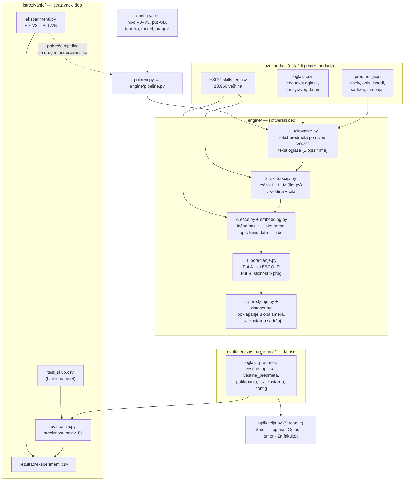

# Pipeline: kurikulum ↔ oglasi za posao

Kod prati metodologiju iz `Istrazivacki_dnevnik.md`. Svaki korak je poseban fajl.

## Arhitektura pipeline-a

Dijagram prikazuje kako podaci prolaze kroz kod: od ulaznih fajlova, kroz pet koraka engine-a, do rezultata (dataset) i aplikacije. Istraživački deo ne pravi poseban sistem, nego isti pipeline pokreće više puta sa drugim podešavanjima.



### Šta ulazi i izlazi iz svakog koraka

| Korak | Ulaz | Izlaz |
|---|---|---|
| 1. `ucitavanje.py` | `predmeti.json`, `oglasi.csv`, nivo iz `config.yaml` | čist tekst svakog predmeta i oglasa |
| 2. `ekstrakcija.py` | tekst | lista veština, uz citat iz teksta za svaku |
| 3. `esco.py` | lista veština, ESCO | ESCO naziv i ID za svaku veštinu (ili „nema u ESCO-u“) |
| 4. `poredjenje.py` | ESCO veštine oglasa i predmeta | za svaku veštinu iz oglasa: pokrivena ili ne, kojim predmetom |
| 5. `poredjenje.py`, `dataset.py` | tabela iz koraka 4 | mera poklapanja po oglasu (oba smera), jaz, zastareo sadržaj, dataset u CSV-u |
| aplikacija | dataset iz `rezultati/` | prikaz za studenta i fakultet |
| evaluacija | dataset + test skup | preciznost, odziv, F1 |
| eksperimenti | `config.yaml` + lista nivoa i puteva | tabela rezultata za sve kombinacije |

## Koji fajl je koji korak

| Korak iz dnevnika | Fajl | Šta radi |
|---|---|---|
| 1. Prikupljanje | `engine/ucitavanje.py`, `engine/krouler.py` | učitava predmete (JSON) i oglase (CSV); određuje nivo teksta V0–V3; osnova za krouler |
| 2. Izvlačenje veština | `engine/ekstrakcija.py` | dve tehnike: `recnik` (ESCO nazivi u tekstu) i `llm` (LLM + citat) |
| 3. Prevođenje na ESCO | `engine/esco.py`, `engine/embedding.py` | prvo tačan naziv; ako ga nema: embedding → top-k kandidata → izbor (LLM ili prag) |
| 4. Poređenje | `engine/poredjenje.py` | pokrivenost svake veštine; mera poklapanja za svaki oglas u **oba smera** |
| 5. Rezultat | `engine/poredjenje.py`, `engine/dataset.py`, `aplikacija.py` | jaz, zastareo sadržaj, dataset, aplikacija |
| 6. Provera | `istrazivanje/evaluacija.py` | preciznost i odziv na test skupu |
| 7–8. Eksperimenti | `istrazivanje/eksperimenti.py` | sve kombinacije V0–V3 × Put A/B |
| ceo tok | `engine/pipeline.py`, `pokreni.py` | povezuje korake 1–5 |

Sva podešavanja su u `config.yaml` (generički engine: smer, predmeti, izvori, model i pragovi se menjaju tamo, ne u kodu).

## Pokretanje

```bash
pip install -r requirements.txt

python pokreni.py                         # ceo pipeline, rezultati u rezultati/primer/
python pokreni.py --nivo V1 --put B       # druga podešavanja
python -m istrazivanje.eksperimenti       # V0–V3 × Put A/B → rezultati/eksperimenti.csv
streamlit run aplikacija.py               # aplikacija u pregledaču
```

## Šta se dobija (dataset)

U `rezultati/<naziv_pokretanja>/`:

| Fajl | Sadržaj |
|---|---|
| `oglasi.csv` | ceo tekst oglasa, izvor, link, datum |
| `predmeti.csv` | tekst predmeta na izabranom nivou |
| `vestine_oglasa.csv` | veština, citat, ESCO naziv i ID, pokrivena ili ne, kojim predmetom |
| `vestine_predmeta.csv` | veština, citat, ESCO naziv i ID, predmet |
| `poklapanja.csv` | za svaki oglas: `oglas_smer` i `smer_oglas` |
| `jaz.csv` | tražene veštine koje smer ne pokriva, po učestalosti |
| `zastareo.csv` | veštine koje se uče, a ne traže (kandidati za proveru) |
| `config.yaml` | podešavanja pokretanja, da bi moglo da se ponovi |

## Rezultat na primeru (izmišljeni podaci)

Pokretanje eksperimenata na podacima iz `primer_podaci/` daje:

| Nivo | Put A: F1 | Put B: F1 |
|---|---|---|
| V0 (naziv + opis) | 0,00 | 0,00 |
| V1 (+ ishodi) | 0,57 | 0,57 |
| V2 (+ sadržaj) | 0,67 | 0,57 |
| V3 (+ materijali) | 1,00 | 0,95 |

Ovi brojevi **ne znače ništa o pravim predmetima**, jer su primeri napravljeni tako da se vidi efekat. Pokazuju samo da eksperiment radi: što više teksta o predmetu, to više veština sistem pronađe.

## Pravi ESCO

1. Preuzeti sa https://esco.ec.europa.eu/en/use-esco/download: Version v1.2.1, Content classification, Language en, File type csv.
2. Iz arhive uzeti `skills_en.csv` i staviti ga u `data/esco/skills_en.csv` (folder `data/` ne ide na git).
3. U `config.yaml` promeniti `esco: data/esco/skills_en.csv` i, po želji, `naziv_pokretanja: pravi_esco`.

Ova publikacija koristi ESCO klasifikaciju Evropske komisije.

## Šta još treba uraditi

1. **Pravi podaci:** tekst 2–3 izabrana predmeta (sa materijalima) u `predmeti.json`, oglasi u `oglasi.csv`, pravi ESCO (`skills_en.csv`) umesto `esco_primer.csv`.
2. **Ivanin dataset:** pretvoriti ga u format `oglas_id, vestina, pokriveno` (vidi `istrazivanje/evaluacija.py`).
3. **Embedding model:** u `config.yaml` umesto `tfidf` staviti višejezički model (npr. `BAAI/bge-m3`). `tfidf` služi samo za probu: ne zna da su „baze podataka“ i „databases“ isto.
4. **LLM:** podesiti `llm.provider` i `llm.model`, ključ staviti u promenljivu okruženja (nikad u kod).
5. **Krouler:** funkciju `izvuci_oglas` u `engine/krouler.py` napisati za izabrani portal.

## Poznata ograničenja

- Tehnika `recnik` nalazi samo veštine napisane istim rečima kao u ESCO-u. Pošto ESCO nema srpski, na srpskim tekstovima propušta mnogo. Zato postoji i `llm`, a evaluacija pokazuje razliku (mera `izvuceno`).
- Veština koje nema u ESCO-u (npr. „React“ u primeru) tehnika `recnik` uopšte ne vidi.
- Poređenje računa samo tačno poklapanje: ako predmet uči SQL, a oglas traži PostgreSQL, to se ne računa kao pokriveno.
