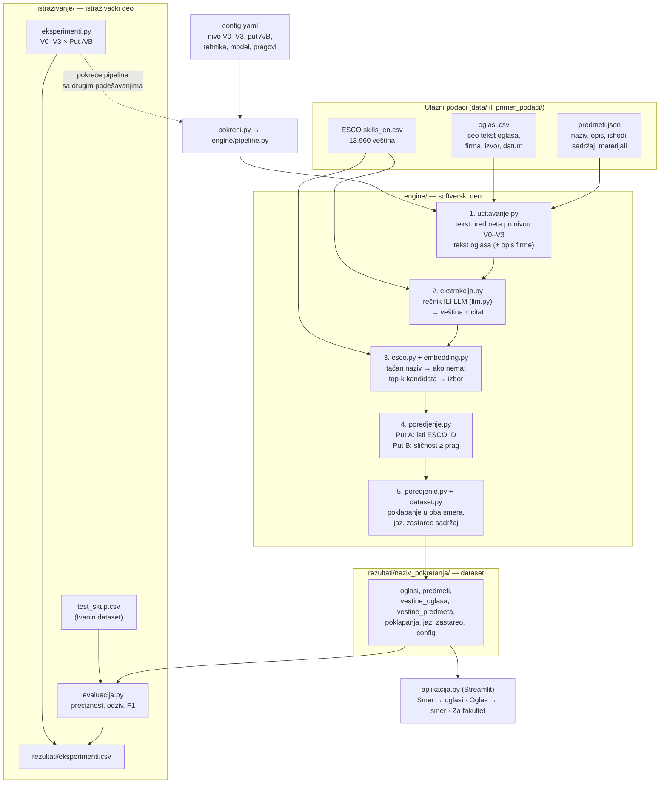

## Arhitektura pipeline-a

Dijagram prikazuje kako podaci prolaze kroz kod: od ulaznih fajlova, kroz pet koraka engine-a, do rezultata (dataset) i aplikacije. Istraživački deo (desno dole) ne pravi poseban sistem, nego isti pipeline pokreće više puta sa drugim podešavanjima.

### Šta ulazi i izlazi iz svakog koraka

| Korak | Ulaz | Izlaz |
|---|---|---|
| 1. `ucitavanje.py` | `predmeti.json`, `oglasi.csv`, nivo iz `config.yaml` | čist tekst svakog predmeta i oglasa |
| 2. `ekstrakcija.py` | tekst | lista veština, uz citat iz teksta za svaku |
| 3. `esco.py` | lista veština, ESCO | ESCO naziv i ID za svaku veštinu (ili „nema u ESCO-u“) |
| 4. `poredjenje.py` | ESCO veštine oglasa i predmeta | za svaku veštinu iz oglasa: pokrivena ili ne, kojim predmetom |
| 5. `poredjenje.py`, `dataset.py` | tabela iz koraka 4 | mera poklapanja po oglasu (oba smera), jaz, zastareo sadržaj, dataset u CSV-u |
| aplikacija | dataset iz `rezultati/` | prikaz za studenta i fakultet |
| evaluacija | dataset + test skup | preciznost, odziv, F1 |
| eksperimenti | `config.yaml` + lista nivoa i puteva | tabela rezultata za sve kombinacije |
